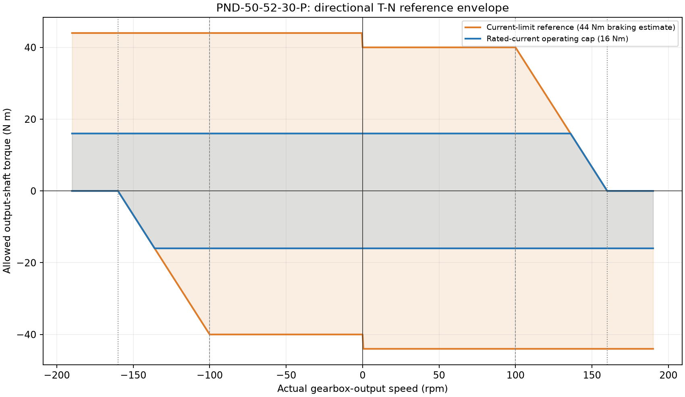

# PNDbotics Ankle Simulation

A parallel ankle mechanism simulation repository for academic research, featuring:
- Shared analytical kinematics in `src/pndbotics_ankle` (IK / FK / Jacobians)
- Theoretical geometric/Jacobian model analysis (workspace, velocity mapping, torque mapping, armature estimation)
- MuJoCo runtime comparison and Pinocchio reduced-order dynamics / visualization scripts
- ADAM Pro robot model (MJCF/URDF + multi-format meshes)

## Motor model: workbook-aligned output-shaft simulation

The four ankle motors now use one [canonical profile](src/pndbotics_ankle/data/pnd_50_52_30_p.json), approved against **row 10, PND-50-52-30-P**, in the user's motor-parameter workbook. Only the selected parameters and source digest are included; the private workbook and its other device data are **not redistributed**.

| Quantity | Current model | Evidence / interpretation |
|---|---:|---|
| Rotor inertia | 0.61 × 10^-4 kg·m² | F10; explicitly labeled simulation data |
| Physical reduction ratio | 30 | H10; applied to inertia once |
| Output-shaft inertia budget | 0.0549 kg·m² | I10 = (E10 + F10) × 30²; E10 is missing, not a measured zero |
| Explicit motor-body axial inertia | 0.0002 kg·m² | Existing MJCF, included in the selected shaft budget |
| Additional joint `armature` | 0.0547 kg·m² | Budget minus explicit contribution, **not** a separately measured value |
| Rated-current operating cap | 16 N·m | Tested output Kt 1.6 N·m/A × rated current 10 A; not a thermal guarantee |
| Same-direction drive reference | 40 N·m | Kt × current limit 25 A |
| Opposite-direction brake reference | 44 N·m | Workbook's +10% estimate; not a measured regenerative limit |
| Reference drive knee / zero | 100 / 160 rpm | X1 / X2; X1 was reported at rated current, so the full-current knee is idealized |

MuJoCo `gear=1` means the **modeled coordinate is already the gearbox output shaft**. Do not multiply the above inertia or torques by the physical gear ratio again. The old extra motor damping of 6 N·m·s/rad and passive-ankle armature of 0.005 are removed; missing motor friction is **unidentified**, not measured to be zero. Other rigid-body/tendon parameters remain unchanged. See the [motor contract and limitations](docs/motor_model.md).

**Important migration:** the four ankle actuators are now fail-closed `general` actuators. Raw XML without the Python bias callback produces **zero ankle motor torque**, rather than silently ignoring T–N. Use the supported [loader](src/pndbotics_ankle/mujoco_io.py) and [MotorRuntime](src/pndbotics_ankle/mujoco_motor.py). The callback applies signed T–N limits at the actual measured speed during `mj_forward`, `mj_step`, batched steps and integration substeps. It requires exclusive use of MuJoCo's process-global user-bias callback.

```bash
pip install -e ".[sim,test]"
python scripts/configure_ankle_motor.py --check
python -m unittest discover -s tests -v
python scripts/kinematics/ankle_speed_torque.py
python scripts/dynamics/ankle_motor_simulation.py --out artifacts/motor_validation
python scripts/dynamics/verify_motor_model.py --results artifacts/motor_validation
```

```python
import mujoco
from pndbotics_ankle.mujoco_io import load_mujoco_model
from pndbotics_ankle.mujoco_motor import MotorRuntime

model = load_mujoco_model()  # clone-relative default; accepts an explicit path
state = mujoco.MjData(model)
with MotorRuntime(model) as motor_runtime:
    motor_runtime.set_mode(state, "continuous")  # default: rated-current operating cap
    state.ctrl[model.actuator("ankleMotor_Left_1").id] = 10.0  # requested output Nm
    motor_runtime.step(state, nstep=10)
```

The [motor-driven recorder](scripts/dynamics/ankle_motor_simulation.py) writes requested, limited and actual generalized torques separately, along with bounds, speed, power, saturation and inertia ledgers. `--mode current_limit` explicitly selects the 40/44 N·m reference; no peak-duration/thermal or electrical model is claimed. Over 160 rpm, same-direction drive goes to zero but braking remains available: **this is not a mechanical hard speed clamp**. The 190 rpm `Va` datum is friction metadata, not a replacement T–N endpoint.

The [executed validation record](docs/motor_model_validation.md) documents **81 passing regressions**, 1,800 native motor-force cases, 28-second integration at two step sizes, exact sampled-state replay, and unchanged source-workbook digest. These are reference-model consistency checks, not hardware certification.



The original model viewer remains a geometric visualization, and the original motor-angle sweep still drives the passive ankle with external test torques. Neither is the new motor-capability validation. Pinocchio scripts remain reduced-order research tools, not T–N-enforced motor simulators.

## 1. Project Overview

This project studies the **kinematics, statics, and dynamics** characteristics of a dual-motor parallel ankle mechanism, with the analytical model centralized in `src/pndbotics_ankle` and cross-checked in MuJoCo / Pinocchio environments.

## 2. Repository Structure

```
pndbotics-ankle-sim/
├── adam_pro/                     # Robot model and mesh assets (MJCF/URDF/STL/DAE/OBJ)
├── src/
│   └── pndbotics_ankle/
│       ├── __init__.py           # Shared analytical kinematics
│       ├── motor.py              # Immutable motor profile and directional limits
│       ├── mujoco_motor.py       # Native measured-speed limiter and inertia validation
│       ├── mujoco_io.py          # Unicode-safe model loading and fixed-shin bench
│       └── data/                 # Approved workbook-derived parameter inputs
├── scripts/
│   ├── kinematics/               # Theoretical model and visualization scripts
│   │   ├── ankle_3d_viewer.py    # Interactive 3D visualization
│   │   ├── ankle_armature.py     # Armature (reflected inertia) calculation
│   │   ├── ankle_speed_torque.py  # Speed-torque curve mapping
│   │   ├── ankle_workspace.py    # Workspace analysis (IK/FK)
│   │   └── plot_ankle_data.py    # Kinematics data plotting
│   └── dynamics/                 # MuJoCo / Pinocchio dynamics scripts
│       ├── ankle_dynamics_headless.py    # Pinocchio without visualization
│       ├── ankle_dynamics_mujoco.py      # src formula vs MuJoCo runtime comparison
│       ├── ankle_dynamics_pinocchio.py   # Pinocchio with Meshcat visualization
│       ├── ankle_motor_simulation.py    # Actual motor-driven recorder
│       ├── verify_motor_model.py        # Native torque, state replay and dt verification
│       └── mujoco_model_viewer.py        # Geometric MuJoCo viewer
├── docs/
│   ├── motor_tn_envelope.png     # Canonical directional motor envelope
│   ├── ankle_joint_tn_envelope.png
│   └── ankle_kinematics_dynamics_notes.md
└── README.md
```

## 3. Dependencies

Recommended: Python 3.10+

Core dependencies (install as needed):
- `numpy`
- `matplotlib`
- `scipy`
- `mujoco`
- `pin`
- `meshcat` (only for `ankle_dynamics_pinocchio.py` visualization)

Installation:

```bash
python -m venv .venv
source .venv/bin/activate
pip install numpy matplotlib scipy mujoco pin meshcat
```

## 4. Quick Start

### 4.1 Theoretical Analysis

```bash
python scripts/kinematics/plot_ankle_data.py
python scripts/kinematics/ankle_workspace.py
python scripts/kinematics/ankle_armature.py
```

### 4.2 MuJoCo / Pinocchio Dynamics

```bash
python scripts/dynamics/mujoco_model_viewer.py
python scripts/dynamics/ankle_dynamics_mujoco.py
python scripts/dynamics/ankle_dynamics_headless.py
python scripts/dynamics/ankle_dynamics_pinocchio.py
```

> Note: All scripts automatically locate the repository root directory, no longer requiring local hardcoded `os.chdir(...)` paths.

### 4.3 Current workflow

1. Use `src/pndbotics_ankle.CustomAnkleKinematics` as the analytical source of truth.
2. Generate theory curves directly from the shared `IK / FK / calc_Jacobians` methods.
3. Compare those theory results against **MuJoCo runtime motor sensors** in `ankle_dynamics_mujoco.py`.
4. Use `ankle_dynamics_headless.py` and `ankle_dynamics_pinocchio.py` for reduced-order rigid-body dynamics in Pinocchio, while still using the same shared kinematics.
5. When theory motor angles are written into MJCF / Pinocchio motor joints, use the calibrated home/sign mapping between:
   - analytical crank angle (`src` variable)
   - XML motor joint coordinate (`adam_pro.xml` / Pinocchio variable)

## 5. Shared Module

The `CustomAnkleKinematics` class has been extracted to a shared module at `src/pndbotics_ankle/`. This eliminates code duplication across multiple scripts and provides a single source of truth for the kinematics model.

This shared model is now used consistently by:
- `plot_ankle_data.py`
- `ankle_workspace.py`
- `ankle_speed_torque.py`
- `ankle_armature.py`
- `ankle_dynamics_simple.py`
- `ankle_dynamics_mujoco.py`
- `ankle_dynamics_headless.py`
- `ankle_dynamics_pinocchio.py`

### Using the Shared Module

```python
import sys
from pathlib import Path
sys.path.insert(0, str(Path(__file__).resolve().parents[1] / "src"))

from pndbotics_ankle import CustomAnkleKinematics

robot = CustomAnkleKinematics()
q1, q2 = robot.IK(0.1, 0.05)  # Inverse kinematics
J_vel, J_tau = robot.calc_Jacobians(0.1, 0.05)  # Jacobians
```

### Key Methods

| Method | Description |
|--------|-------------|
| `IK(theta_x, theta_y)` | Inverse kinematics: motor angles from ankle pose |
| `FK(q1, q2)` | Forward kinematics: ankle pose from motor angles |
| `calc_Jacobians(tx, ty)` | Compute velocity and torque Jacobian matrices |
| `calc_R(tx, ty)` | Compute rotation matrix for ankle orientation |

> Important: the analytical motor angle returned by `CustomAnkleKinematics` is a **crank-angle variable**, while the XML / Pinocchio motor joint coordinate uses a different sign and home offset. Scripts that compare or visualize motor states must apply the calibrated mapping between these two coordinate definitions.

## 6. Naming Conventions

- Directories: Semantic classification (`scripts/kinematics`, `scripts/dynamics`)
- Scripts: `snake_case` English naming
- Documentation: Centralized in `docs/`
- Models: Centralized in `adam_pro/`

## 7. Recommendations for Academic Use

If used for papers/reports, clearly state in the methods section:
- Source of theoretical model parameters (link lengths, installation angles)
- Error sources between theory and simulation (coordinate conventions, home-offset calibration, compliance, numerical solution accuracy)
- Calibration process for joint workspace and torque boundaries

## 8. Future Extensions

- Add unified configuration file (e.g., `configs/ankle_geometry.yaml`)
- Extend regression tests with measured workspace/singularity and hardware calibration data
- Add experimental data import/export specifications (CSV + plots)
