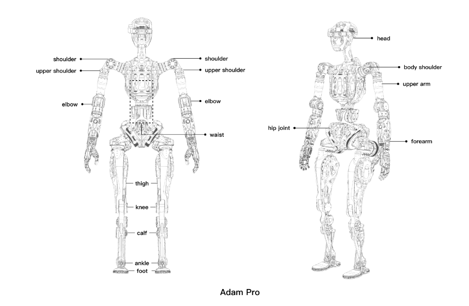
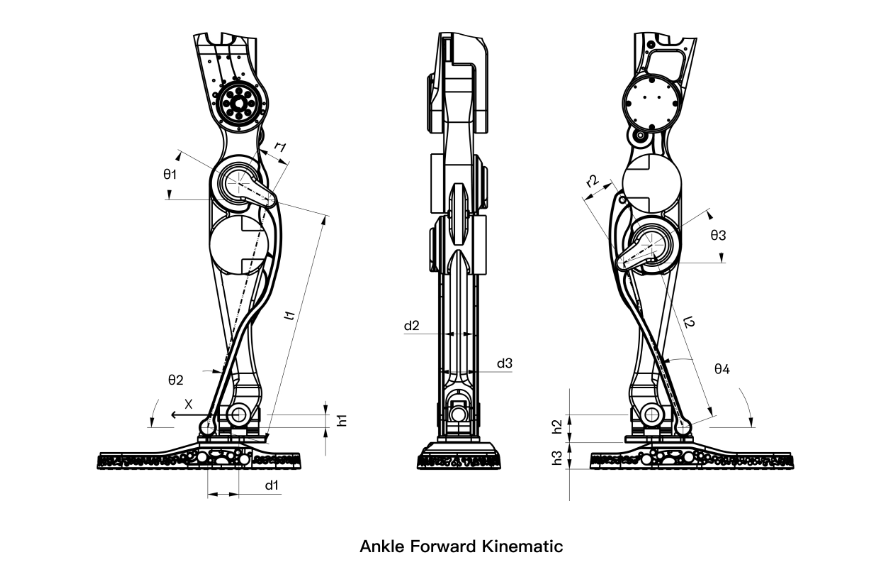
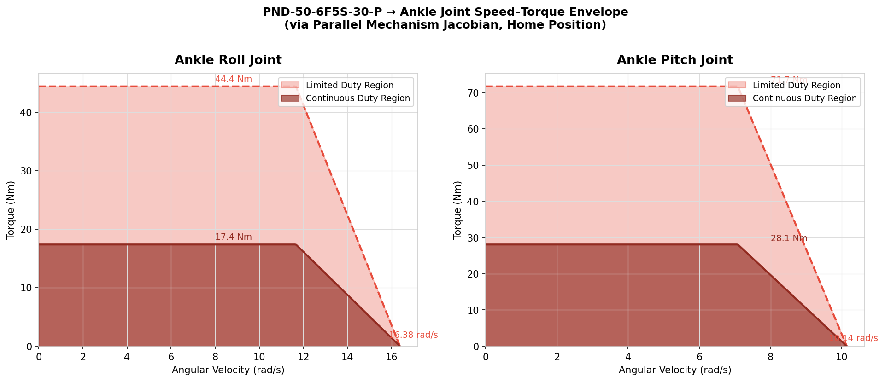

# Parallel Ankle Mechanism: Kinematics and Dynamics Notes

This document summarizes the theoretical model, implementation logic, and verification workflow used in this repository for the dual-motor parallel ankle mechanism on ADAM Pro.

## 1. Robot and Mechanism Overview

### 1.1 ADAM Pro full-body model



The ankle mechanism studied in this repository is integrated into the ADAM Pro humanoid MJCF model in `adam_pro/adam_pro.xml`.

### 1.2 Ankle geometry reference



The ankle is a **two-motor parallel mechanism**. Each motor drives a short crank, and each crank is connected to the foot platform by a long link. The foot platform provides two rotational degrees of freedom:

- roll about the \(X\)-axis
- pitch about the \(Y\)-axis

The model used in code is implemented in `src/pndbotics_ankle/__init__.py` as `CustomAnkleKinematics`.

---

## 2. Coordinate System and Parameters

The shared kinematics module uses the following right-handed frame:

- \(X\): forward
- \(Y\): left
- \(Z\): upward

The ankle pose is parameterized by:

- \(t_x\): roll angle
- \(t_y\): pitch angle

The rotation order used in the implementation is:

\[
R(t_x, t_y) = R_x(t_x) R_y(t_y)
\]

and the explicit rotation matrix is:

\[
R =
\begin{bmatrix}
\cos t_y & \sin t_x \sin t_y & \cos t_x \sin t_y \\
0 & \cos t_x & -\sin t_x \\
-\sin t_y & \cos t_y \sin t_x & \cos t_x \cos t_y
\end{bmatrix}
\]

The main geometric parameters in the current implementation are:

- crank radii: \(r_1 = 40\text{ mm},\; r_2 = 40\text{ mm}\)
- long links: \(l_1 = 280\text{ mm},\; l_2 = 208\text{ mm}\)
- mounting offsets: \(h_1,h_2,h_3,d_1,d_2,d_3\)
- installation angles: \(\theta_1,\theta_2,\theta_3,\theta_4\)

These values are defined directly in `CustomAnkleKinematics.__init__()`.

---

## 3. Mechanism Geometry

For each side chain:

- \(A_i\): motor axis center
- \(B_i\): crank tip
- \(C_i\): foot attachment point

The geometric constraint is:

\[
\|B_i - C_i\| = l_i, \quad i \in \{1,2\}
\]

The foot attachment points are defined in the ankle body frame and rotated into the world frame by:

\[
C_i^O = R(t_x, t_y) C_i^W
\]

The crank-tip positions are determined by motor angles \(q_1, q_2\):

\[
B_1 = A_1 +
\begin{bmatrix}
r_1 \cos q_1 \\
0 \\
r_1 \sin q_1
\end{bmatrix},
\qquad
B_2 = A_2 +
\begin{bmatrix}
r_2 \cos q_2 \\
0 \\
r_2 \sin q_2
\end{bmatrix}
\]

---

## 4. Inverse Kinematics (IK)

The inverse kinematics problem is:

> Given ankle pose \((t_x, t_y)\), solve motor angles \((q_1, q_2)\).

For each branch, define:

\[
U = A_x - C_x,
\qquad
V = A_y - C_y,
\qquad
W = A_z - C_z
\]

The implementation then builds:

\[
K_1 = 2rW,
\qquad
K_2 = 2rU,
\qquad
K_3 = l^2 - r^2 - U^2 - V^2 - W^2
\]

and the discriminant:

\[
s_v = K_1^2 + K_2^2 - K_3^2
\]

If \(s_v < 0\), the target pose is outside the reachable workspace.

The motor angle is then solved by:

\[
q = \operatorname{atan2}(K_3, -\sqrt{s_v}) - \operatorname{atan2}(K_2, K_1)
\]

This is exactly the logic used in `CustomAnkleKinematics.IK()`.

---

## 5. Forward Kinematics (FK)

The forward kinematics problem is:

> Given motor angles \((q_1, q_2)\), solve the ankle pose \((t_x, t_y)\).

This repository solves FK numerically using Newton iteration.

The residual vector is built from the two link-length constraints:

\[
g(t_x,t_y)=
\begin{bmatrix}
\|B_1 - C_1^O\|^2 - l_1^2 \\
\|B_2 - C_2^O\|^2 - l_2^2
\end{bmatrix}
\]

The solver iterates:

\[
\Delta = J^{-1} g,
\qquad
\begin{bmatrix} t_x \\ t_y \end{bmatrix}_{k+1}
=
\begin{bmatrix} t_x \\ t_y \end{bmatrix}_{k}
- \Delta
\]

where \(J\) is the analytical Jacobian of the constraint equations with respect to \((t_x,t_y)\).

This is implemented in `CustomAnkleKinematics.FK()`.

---

## 6. Velocity Jacobian and Torque Jacobian

The repository uses two related Jacobians.

### 6.1 Velocity Jacobian

The analytical velocity Jacobian returned by `calc_Jacobians()` is:

\[
\dot q_m = J_{vel} \, \dot q_j
\]

where:

- \(\dot q_m = [\dot q_1, \dot q_2]^T\): motor angular velocities
- \(\dot q_j = [\dot t_x, \dot t_y]^T\): ankle roll/pitch velocities

In code, this is built from the geometric constraint differential form. For each branch, the crank-tip linear velocity contribution and foot-attachment motion contribution are combined to form a 2x2 mapping matrix.

### 6.2 Torque Jacobian

By virtual work:

\[
\tau_m^T \dot q_m = \tau_j^T \dot q_j
\]

Since \(\dot q_m = J_{vel} \dot q_j\), the motor torque mapping is:

\[
\tau_m = J_{vel}^{-T} \tau_j
\]

The implementation denotes:

\[
J_{\tau} = J_{vel}^{-T}
\]

therefore:

\[
\tau_m = J_{\tau} \tau_j
\]

This is computed in `CustomAnkleKinematics.calc_Jacobians()` as:

\[
J_{\tau} = (J_{vel}^T)^{-1}
\]

---

## 7. Speed–Torque Mapping to Joint Space

The script `scripts/kinematics/ankle_speed_torque.py` maps motor limits to ankle output capability.

The motor speed–torque curve is modeled as a piecewise linear envelope:

\[
\tau_{motor}(\omega)=
\begin{cases}
\tau_{flat}, & |\omega| \le \omega_{corner} \\
\tau_{flat} \dfrac{\omega_{max}-|\omega|}{\omega_{max}-\omega_{corner}}, & \omega_{corner}<|\omega|\le\omega_{max} \\
0, & |\omega|>\omega_{max}
\end{cases}
\]

Using the Jacobians:

\[
\dot q_m = J_{vel} \, \dot q_j,
\qquad
\tau_m = J_{\tau} \, \tau_j
\]

the script computes, for a chosen output axis, the joint-speed / joint-torque boundary by enforcing that **both motors remain within their own speed and torque limits**.

The generated figure is:



---

## 8. Dynamics Model

The repository contains two dynamics viewpoints:

1. **MuJoCo ground-truth model** in `scripts/dynamics/ankle_dynamics_mujoco.py`
2. **Pinocchio-based reduced dynamic mapping** in `scripts/dynamics/ankle_dynamics_headless.py` and `ankle_dynamics_pinocchio.py`

### 8.1 Joint-space equation of motion

The ankle joint-space dynamics can be written in standard form:

\[
M_j(q) \ddot q_j + h_j(q,\dot q) = \tau_j
\]

where:

- \(q_j = [t_x, t_y]^T\)
- \(M_j\): joint-space inertia matrix
- \(h_j\): nonlinear term containing Coriolis, centrifugal, and gravity
- \(\tau_j\): ankle generalized torque

### 8.2 Mapping to motor space

If the local instantaneous kinematic relation is:

\[
\dot q_j = J_{m2j} \dot q_m
\]

then by kinetic-energy consistency and virtual work:

\[
M_m = J_{m2j}^T M_j J_{m2j}
\]

and

\[
\tau_m = J_{m2j}^T \tau_j
\]

This is the mapping now used in `ankle_dynamics_headless.py`.

### 8.3 Numerical Jacobian used in the Pinocchio script

The headless Pinocchio script computes:

\[
J_{m2j} = \frac{\partial [\text{pitch},\text{roll}]}{\partial [q_{m1}, q_{m2}]}
\]

numerically by finite differences:

\[
\frac{\partial \text{pitch}}{\partial q_{mi}} \approx
\frac{\text{pitch}(q_{mi}+\delta)-\text{pitch}(q_{mi}-\delta)}{2\delta}
\]

\[
\frac{\partial \text{roll}}{\partial q_{mi}} \approx
\frac{\text{roll}(q_{mi}+\delta)-\text{roll}(q_{mi}-\delta)}{2\delta}
\]

This gives a 2x2 Jacobian directly from motor coordinates to ankle coordinates.

### 8.4 Mass matrix extraction in Pinocchio

The full rigid-body model is loaded from MJCF and Pinocchio computes the full generalized mass matrix:

\[
M_{full}
\]

The script extracts the pitch/roll block:

\[
M_j = M_{full}[\{\text{pitch},\text{roll}\}, \{\text{pitch},\text{roll}\}]
\]

and then maps it to motor space:

\[
M_m = J_{m2j}^T M_j J_{m2j}
\]

### 8.5 Gravity and nonlinear terms

Pinocchio provides the nonlinear term vector `nle`, which includes gravity and velocity-dependent effects:

\[
h_j(q,\dot q)
\]

The current script computes motor-space compensation torque by:

\[
\tau_m = J_{m2j}^T h_j
\]

To keep this consistent, the headless script first maps motor velocity to joint velocity:

\[
\dot q_j = J_{m2j} \dot q_m
\]

and only then queries the nonlinear dynamics term.

### 8.6 Inverse dynamics in the current reduced form

For a desired ankle acceleration \(\ddot q_j\), the script solves approximately:

\[
\ddot q_m \approx J_{m2j}^{-1} \ddot q_j
\]

and then computes:

\[
\tau_m = M_m \ddot q_m + c_g
\]

where \(c_g\) is the mapped nonlinear torque term.

This is a useful local approximation near a given pose. For high-speed motion, the more complete form should also include the Jacobian time-derivative term:

\[
\ddot q_j = J_{m2j} \ddot q_m + \dot J_{m2j} \dot q_m
\]

At present, the headless script is mainly a **local analysis / verification tool**, not a full constrained multibody controller.

---

## 9. MuJoCo as Ground Truth

The script `scripts/dynamics/ankle_dynamics_mujoco.py` uses MuJoCo geometry directly as an external reference.

The main idea is:

1. Fix ankle pitch and roll in the MJCF model.
2. Read the actual site positions of:
   - `ankleLeft_B1`, `ankleLeft_B2`
   - `ankleToeLeft_C1`, `ankleToeLeft_C2`
3. Solve motor angles numerically such that:

\[
\|B_1 - C_1\| = L_1,
\qquad
\|B_2 - C_2\| = L_2
\]

This provides an independent geometric solution that does not depend on the analytical implementation details in `CustomAnkleKinematics`.

Therefore, MuJoCo is used in this repository as a **ground-truth reference** for checking:

- motor-angle prediction
- workspace consistency
- geometric parameter consistency
- error trends under pitch/roll sweeps

---

## 10. MJCF Mass and Inertia Definition

The ankle dynamics rely on inertial data already defined inside `adam_pro/adam_pro.xml`.

Important left-ankle bodies include:

- `ankleMotorLeft_1` and `ankleMotorLeft_2`
- `anklePitchLeft`
- `toeLeft`

The `toeLeft` body acts as the distal foot segment and contains the `ankleRoll_Left` joint. In other words, the repository does **not** define a separate body literally named `foot`; the effective foot segment is represented by `toeLeft` / `toeRight`.

Examples from the MJCF model:

- ankle motor inertial:

```xml
<inertial pos="0 0 0" mass="0.35" diaginertia="0.0002 0.0002 0.0002" />
```

- ankle pitch inertial:

```xml
<inertial pos="0 0 0" mass="0.0301423" diaginertia="3.14e-06 3.14e-06 2.04e-06" />
```

- toe / foot inertial:

```xml
<inertial pos="0.0374997 -4.016e-05 -0.0419674"
          quat="-0.0209271 0.743591 -0.0168677 0.668094"
          mass="0.634796"
          diaginertia="0.00233488 0.00226889 0.000434699" />
```

So the dynamic anomalies previously observed in the scripts were **not caused by missing XML mass**, but by the reduced-model mapping and Jacobian handling in the analysis code.

---

## 11. Relationship Between Scripts

### Kinematics scripts

- `ankle_workspace.py`: workspace scan
- `plot_ankle_data.py`: data plotting and pose analysis
- `ankle_armature.py`: reflected inertia / armature analysis
- `ankle_speed_torque.py`: motor-to-joint performance mapping

### Dynamics scripts

- `ankle_dynamics_mujoco.py`: MuJoCo-based verification
- `ankle_dynamics_headless.py`: lightweight Pinocchio analysis without visualization
- `ankle_dynamics_pinocchio.py`: similar analysis with visualization support
- `mujoco_model_viewer.py`: direct model inspection

The intended workflow is:

1. use `CustomAnkleKinematics` as the analytical source of truth;
2. verify geometry and trends with MuJoCo;
3. use Pinocchio for reduced-order dynamic inspection and parameter sensitivity analysis.

---

## 12. Practical Notes and Limitations

1. The analytical model uses dimensions in **mm**, while MuJoCo and Pinocchio use **m**.
2. The Jacobian-based dynamic mapping is **local** and depends on the operating pose.
3. Near singular configurations, Jacobian conditioning deteriorates and both torque and apparent inertia can grow rapidly.
4. The headless inverse-dynamics demonstration currently neglects the full \(\dot J \dot q\) term in acceleration mapping, so it should be viewed as a local engineering approximation.
5. MuJoCo remains the preferred ground-truth tool for cross-checking large-motion behavior.

---

## 13. Reproducibility

Typical commands:

```bash
python scripts/kinematics/ankle_workspace.py
python scripts/kinematics/plot_ankle_data.py
python scripts/kinematics/ankle_speed_torque.py

python scripts/dynamics/ankle_dynamics_mujoco.py
python scripts/dynamics/ankle_dynamics_headless.py
python scripts/dynamics/ankle_dynamics_pinocchio.py
```

---

## 14. Summary

This repository models the ADAM Pro ankle as a two-input, two-output parallel mechanism. The core contributions of the codebase are:

- an analytical geometric model for IK/FK/Jacobians;
- Jacobian-based speed/torque transmission analysis;
- reduced-order dynamic mapping between ankle space and motor space;
- MuJoCo-based geometric verification as ground truth;
- MJCF-integrated inertial parameters for dynamic simulation.

Together, these tools provide a practical workflow for mechanism analysis, dynamic intuition, and model verification.
