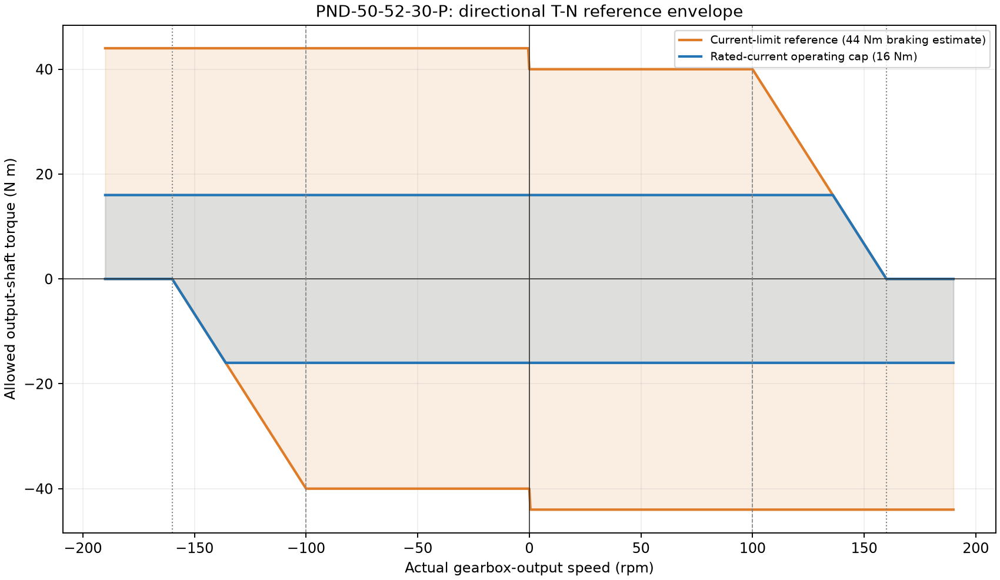

# 并联踝电机参数选取与 MuJoCo 建模步骤说明

> 本文回答：**为什么选、如何选、选了什么、参数代表什么、如何落到模型、怎样验收。**
> 适用版本：物理实现基线 `d662ed967e817fb4fab08f9af94a41eaba2645b4`；配置标识 `pnd_50_52_30_p_row10_directional_v1`。
> 本次是“既定电机的仿真参数选取”，**不是**根据整机负载完成了电机硬件选型，也不是实物电机全工况标定。

## 0. 先说结论：为什么这样选

1. **型号以用户确认优先。** 用户已确认四个踝电机均以主表第 10 行 **PND-50-52-30-P** 及附图为准。因此选此行是明确的设计输入，不是因为空载仿真扭矩小，就证明该型号满足整机步态、峰值负载或温升要求。旧型号标题不自动视为同款。
2. **优先使用同一行、同一轴侧、同一测试口径。** 不从不同配置中挑各自有利的数值拼成一个“更强的电机”。惯量、扭矩常数、电流和速度节点统一追溯到所选行及定义表头。
3. **只推导能由现有证据支持的量。** 例如减速比平方折算惯量、扭矩常数乘电流。估算、仿真数据和未知值分别标识，不把它们写成实测值。
4. **以输出轴为统一接口。** MJCF 已显式建出减速器输出端曲柄，故在此轴输入扭矩、读取速度、分配惯量；避免再乘一次减速比。
5. **参数必须同时约束分析和实际积分。** 不能只把图上的数字改对，而实际 MuJoCo 仍用另一组 armature、阻尼或限幅。

### 本轮选参逻辑

```text
确认型号和应用范围
  → 核对来源、单元格、单位、轴侧与证据等级
  → 提取原始参数（缺失项仍保留缺失）
  → 推导输出惯量及扭矩/速度边界
  → 明确惯量分摊、未建模损耗和参考包络等假设
  → 由单源配置生成 MJCF 缓存并绑定原生限幅
  → 检查实际广义力、真实积分、状态重放和步长敏感性
  → 保存依据、限制、版本和验证结果
```

## 1. 第一步：锁定来源，不先凭经验填数

### 1.1 来源记录

原始文件名称为 `PND人形执行器物理参数_20251216.xlsx`，所选工作表为“执行器物理参数”，型号单元格为 C10。原始私有文件不随仓库分发；公开的[参数配置与来源记录](../src/pndbotics_ankle/data/pnd_50_52_30_p.json)仅保留选定行的必要数值、定义及哈希。

```text
原始文件 SHA-256：
401a1d96f77895c46ba5fa4dffff29da652253f1dc7ef87c62595933ef3a8740
```

**操作方法：** 同时读取“单元格公式”和“已有计算结果”，再看表头、单位行及附图定义；不要只读取一个显示数值。特别检查 F1 的仿真标记、J1 的测试标记、N1 的估算规则、O1 的工况说明，以及第 3 行的速度单位。

### 1.2 四种证据不能混写

| 标识 | 本文含义 | 本次例子 | 使用原则 |
|---|---|---|---|
| 原始输入 | 来自指定行的数值，可信度继续按其原注释判断 | F10 的 0.61、J10 的 1.6 | 原始输入不自动等于实测 |
| 公式推导 | 用已知输入和明确公式得到 | 0.0549、16、40 N·m | 保留公式、单位和轴侧 |
| 建模约定 | 为使软件模型可执行而明确选定的策略 | 分摊 0.0547、零速 ±40、缺失损耗不建模 | 不能冒充厂家给定参数 |
| 未知/未验证 | 无足够证据确定的量或工况 | 减速器惯量、摩擦、热与再生限制 | 不随意补“经验值”，不声称为物理零 |

**为什么不用另一套常数？** 附件 2 的 PNDrive 名义转子常数 `0.0592 × 30 = 1.776 N·m/A` 及其限流扭矩属于另一套配置。当前主表使用测试常数 1.6。两者不能不加解释地混用，也不由两者的比值擅自构造效率模型。

## 2. 第二步：先确定轴侧，再统一单位

### 2.1 三个层级的量不能混为一谈

| 层级 | 物理对象 | 本次处理 |
|---|---|---|
| 电机输入/转子侧 | 减速器之前的转子角速度与惯量 | F10 的惯量在这一侧；需经 N² 折算 |
| 减速器输出/曲柄侧 | 驱动并联杆的两个曲柄 | MuJoCo 四个电机 joint 均在这一侧；扭矩、速度和惯量预算在此统一 |
| 踝 roll/pitch 侧 | 机构输出姿态 | 通过姿态相关雅可比映射，不能把某一个轴的电机惯量直接抄到此处 |

物理减速比 N=30，而 MJCF actuator `gear=1`。这并非声称没有减速器，而是因为减速作用已经体现在所用输出侧参数与坐标中。若把输出惯量再乘 30²、或把输出扭矩再乘 30，均会重复折算。

### 2.2 单位核对表

| 原始表达 | 统一表达 | 为什么这样做 |
|---|---|---|
| F10：0.61，列单位为 10^-4 kg·m² | J_rotor = 0.000061 kg·m² | 0.61 不是直接的 SI 惯量 |
| I10：549，列单位为 10^-4 kg·m² | J_out = 0.0549 kg·m² | 与转子侧值不同，已含减速比平方 |
| rpm | rad/s = rpm × 2π/60 | MuJoCo 速度采用 rad/s；使用精确 π，不复用 6.28 近似缓存 |
| N·m/A | 输出轴扭矩/所给电流口径 | 不再额外乘减速比；不擅自认定 RMS/峰值/Iq 定义 |

100、160、190 rpm 分别约为 10.471976、16.755161、19.896753 rad/s。U 列上层标题含 rad/s 字样，但第 3 行和相邻 V 列换算公式表明 U10=190 按 rpm 记录；本次只将其作为摩擦元数据保留。

## 3. 第三步：选惯量并分配 armature

### 3.1 选哪些惯量，为什么

| 量 | 数值/出处 | 代表什么 | 本次为何采用或保留 |
|---|---|---|---|
| J_rotor | F10：0.61 × 10^-4 kg·m² | 电机输入侧转子储存转动动能的惯量 | 用户指定行；F1 明确为仿真数据，不称实测 |
| J_reducer_input | E10：空白 | 折到电机输入侧的减速器惯量 | 保留未知；不能从空白推断实体惯量为零 |
| N | H10：30 | 输入轴/输出轴速度比的幅值 | 用于一次惯量折算 |
| J_out | I10 公式结果：0.0549 kg·m² | 工作簿已知输入项折到输出侧的等效惯量预算 | 与当前输出轴建模坐标对应 |

### 3.2 如何从原表算到输出侧

```text
J_input = J_rotor + J_reducer_input
J_out = J_input × N²

按工作簿空白求和规则复现已知部分：
J_out = (0.61 × 10^-4) × 30² = 0.0549 kg·m²
```

**为什么是平方？** 理想固定传动比下，转子速度是输出速度的 N 倍；由同一转动动能折算到输出坐标，等效惯量随 N² 放大。此处只是轴侧折算，不是再给机构增加一份新的惯量。

注意：0.0549 是当前工作簿规则下的**已知等效预算**。由于 E10 缺失，不能称为“完整减速器惯量已经测得”。每个电机各用一份，不把四电机惯量简单相加后塞进一个踝轴。

### 3.3 为什么 MuJoCo armature 是 0.0547，而不是再填 0.0549

MuJoCo 的 `armature` 是**刚体模型之外的附加广义惯量**，不等同于该轴全部惯量。相关定义见 [MuJoCo 官方 joint-armature 说明](https://mujoco.readthedocs.io/en/stable/XMLreference.html#body-joint-armature)。

原显式 motor body 的轴向惯量贡献为 0.0002 kg·m²。默认 `included_in_profile_total` 把这项纳入 0.0549 总轴预算，因此：

```text
J_armature = J_budget - J_explicit_axis
           = 0.0549 - 0.0002
           = 0.0547 kg·m²

编译后的电机直接轴惯量块：0.0002 + 0.0547 = 0.0549 kg·m²
```

例如输出轴角加速度为 10 rad/s² 时，仅这份预算对应的惯性扭矩为 0.549 N·m，其中附加 armature 项是 0.547 N·m，显式体项是 0.002 N·m；这不是完整负载所需扭矩，重力、机构刚体和损耗尚需另算。

**此项选择的性质：** 0.0547 是预算分摊结果，不是工作簿测得的“隐藏转子惯量”。原有 0.35 kg 质量及空间惯量没有据此完成 CAD 标定，也没有证明显式体一定属于转子内部。

| 预算策略 | 附加 armature | 直接轴总惯量 | 何时才能选 |
|---|---:|---:|---|
| included_in_profile_total（本次默认） | 0.0547 | 0.0549 | 选择既有显式项包含于指定总预算的约定 |
| external_extra（备选） | 0.0549 | 0.0551 | CAD/辨识证明显式体是额外外部构件时重新建账 |

在默认策略下直接填 0.0549 会多算 0.0002；在“外部额外构件”策略下，0.0551 则可能是合理总量。**本轮轨迹验证针对默认策略**；备选策略不能只改一个标签就沿用本轮所有断言和结果，须同步更新总预算、相关分析与回归标准。

## 4. 第四步：选扭矩常数、电流及操作限额

| 参数 | 选值与来源 | 物理含义 | 选择理由/证据限制 |
|---|---|---|---|
| Kt_output | J10：1.6 N·m/A | 主表口径下输出扭矩与电流的比例 | J1 标记测试值；不混用其他驱动配置常数 |
| I_rated | K10：10 A | 表内额定电流 | 未给温度、冷却、持续时间及电流定义，不能据此认定完整热能力 |
| I_limit | L10：25 A | 表内限流设置 | 用于推算参考驱动扭矩，不等于已仿真电流环 |
| τ_rated_cap | 1.6 × 10 = 16 N·m | 额定电流推算的操作限额 | 不是独立实测连续热额定扭矩曲线 |
| Y1 / τ_drive | M10：1.6 × 25 = 40 N·m | 与转动方向相同的参考驱动上界 | 同一行、同一扭矩常数口径下推导 |
| Y2 / τ_brake | N10：40 × 1.1 = 44 N·m | 与转动方向相反的参考制动上界 | N1 明确按相差 10% 处理；估算而非独立制动测试 |

默认采用 `continuous`，意为**额定电流操作限额**；显式选择 `current_limit`（或别名 `peak`）才使用 40/44 参考。较低默认限额降低指令幅值，但不能替代电气、热、寿命或再生安全认证。

**为什么不记录“实测电流 = 扭矩/1.6”？** 尤其 44/1.6=27.5 A，已超过 25 A。说明该制动估算不能冒充严格限相电流模型。本实现的控制输入是输出轴 N·m，不是电压，也没有生成电流动态状态。

## 5. 第五步：按方向构造 T–N，而不是只填一个峰值

### 5.1 选择哪些速度节点

| 量 | 所选值/出处 | 含义 | 为什么如此使用 |
|---|---|---|---|
| X1 | O10：100 rpm | 附图驱动下降段的参考拐点 | O1 说明是在额定电流下的速度；40 N·m 延伸到此处是理想参考，非已测完整 25 A 曲线 |
| X2 | Q10：160 rpm | 台架空载背景下的驱动零扭矩节点 | 用于参考驱动线终点，不是强制机械限速 |
| Va | U10：190 rpm | 摩擦全激活速度/另一空载测试条件的元数据 | Fs/Fd 未给，不能只凭 Va 构造摩擦，更不能替换 X2 |

### 5.2 先构造驱动幅值，再按符号选区间

令 n 为实际输出轴转速的绝对值，单位 rpm。若 MuJoCo 读取的实际角速度为 ω（rad/s），先换算 `n = abs(ω) × 60 / (2π)`，再代入下式：

```text
D(n) = 40                          n ≤ 100
       40 × (160 - n) / (160 - 100) 100 < n < 160
       0                           n ≥ 160
B = 44
```

驱动与制动由机械功率 `P = τ × ω` 的符号区分。速度和扭矩同号为驱动，异号为制动；反向旋转采用镜像参考模型，不声称两方向都做过独立实测。

这里 ω 的单位为 rad/s，先换算 `n = abs(ω) × 60/(2π)`，再代入以 rpm 为自变量的 D(n)。

| 实际速度 | current_limit 允许扭矩区间 |
|---|---|
| ω > 0 | [-44, D(n)] |
| ω < 0 | [-D(n), +44] |
| 精确 ω = 0 | 保守取 [-40, +40]，不在静止状态额外借用制动估算 |

`continuous` 在此基础上与 [-16,16] 求交。因此驱动幅值为 `min(16, D)`，制动幅值为 16。由 `40 × (160-n)/60 = 16` 得到交点 **136 rpm**：这是所选“参考包络与操作限额求交”政策的计算结果，**不是新测出来的额定工况拐点**，也不是已验证的 10 A 完整转矩—转速曲线。不能把整条峰值曲线简单乘 16/40 冒充这一政策。



### 5.3 手算例子：检查模型是否照着规则执行

| 模式 | 实际速度 rpm | 请求 N·m | 输出 N·m | 原因 |
|---|---:|---:|---:|---|
| current_limit | +130 | +100 | +20 | D = 40×30/60 = 20，驱动饱和 |
| current_limit | +130 | +10 | +10 | 请求未超上界，不应再乘 0.5 变成 5 |
| current_limit | +130 | -100 | -44 | 反向扭矩对应制动，不套同向驱动的 20 |
| current_limit | -130 | +100 | +44 | 负速度、正扭矩是制动 |
| current_limit | +190 | +100 | 0 | 同向驱动越过 X2，关闭驱动力 |
| current_limit | +190 | -100 | -44 | 外载仍可拖到超速，参考制动仍存在 |
| continuous | +130 | +100 | +16 | 在参考 20 上再叠加额定电流操作限额 |
| continuous | +145 | +100 | +10 | 参考驱动已低于 16，取更严格的 10 |

最终执行 `τ_applied = clip(τ_requested, lower(ω_actual), upper(ω_actual))`。限幅读**实际**速度，不读目标速度；不能硬剪 qvel 来制造“绝不会超速”。超过 X2 后维持制动是模型外推，没有保证真实母线能吸收再生能量。

## 6. 第六步：区分“没选的物理参数”和“实验设置”

### 6.1 不凭空补齐的量

| 项目 | 本次处理 | 原因与物理含义 |
|---|---|---|
| 电机额外粘性阻尼 b | MJCF damping=0 | 未辨识，表示此项未建模，不是测得真实电机无损耗 |
| 静摩擦/动摩擦 | frictionloss=0；Fs/Fd 保持未知 | S10/T10 空白；Va 不能单独决定摩擦幅值 |
| 电压、R/L、电流环、效率 | 不构造电气动态 | 没有可验证输入，故不强行拟合 MuJoCo dcmotor |
| 热容、热阻、峰值持续时间 | 不构造温升/热保护状态 | 不能由 10 A 或 25 A 单独推导 |
| 制动母线吸收/过压/超速保护 | 未验证 | 制动扭矩估算并非电气保护模型 |

旧电机 damping=6 缺乏所选表格依据；在 100 rpm 时会额外消耗 `6 × 10.471976 = 62.8319 N·m`，已大于 40 N·m 驱动参考。这是不能继续把该数当作已匹配电机损耗的明确警示，但**不证明实际损耗为零**。

### 6.2 保留或选定的非厂家参数

| 项目 | 当前设置 | 为什么保留/采用，能说明什么 |
|---|---|---|
| 被动踝轴额外 armature | 0 | 清除原继承的 0.005 占位；电机反射效应已由显式电机运动产生，不再重复添加 |
| 被动踝轴阻尼 | 原值 0.05 N·m·s/rad | 原机构结构项，未称为电机表的测量结果 |
| tendon 刚度/阻尼 | 原值 1e6 N/m、2000 N·s/m | 保留原柔性杆长近似，本次未做机构辨识 |
| 原刚体质量、空间惯量、几何 | 保留原模型 | 不是本次电机参数来源，也不因成功积分就被认定为 CAD 已标定 |
| PD 比例/微分增益 | 110 N·m/rad、2.4 N·m·s/rad | 演示控制器设置，不是厂家电机参数，也没有宣称最优整机控制器 |
| 加速度前馈 | 总轴预算 × 目标角加速度 | 默认策略使用 0.0549，不只用隐藏 armature 0.0547 |
| 步长与记录 | 1 ms；用 0.5 ms 复核 | 选择机械积分设置并检查数值敏感性，不代表实测电流环周期 |
| 暖机/轨迹长度 | 1 s / 28 s | 数值初始化与演示工况，不是热稳态或峰值持续时间测试 |

虽然 PD 微分增益与粘性阻尼可能具有相同量纲，**控制器 KD=2.4 不等于机械电机阻尼 b=2.4**。不能互相抄数。

## 7. 第七步：落实到四个 MuJoCo 电机

### 7.1 轴名与落点

四个对象为 `ankleMotor_Left_1`、`ankleMotor_Left_2`、`ankleMotor_Right_1`、`ankleMotor_Right_2`。统一型号来自用户指定，不代表已逐台识别个体差异。

| 软件落点 | 写入或检查的量 | 为何需要 |
|---|---|---|
| [单源配置](../src/pndbotics_ankle/data/pnd_50_52_30_p.json) | 原始参数、单位、来源、未知项、预算策略 | 避免分析脚本与模型各存一份不同数字 |
| [MotorSpec](../src/pndbotics_ankle/motor.py) | 统一推导惯量、速度和有符号扭矩区间 | 同一套选参规则服务所有入口 |
| [同步工具](../scripts/configure_ankle_motor.py)与[主 MJCF](../adam_pro/adam_pro.xml) | armature、gear、三层静态护栏、ABI 与模式槽 | XML 是可检查的缓存，不是另一份手填参数源 |
| [运行时](../src/pndbotics_ankle/mujoco_motor.py) | 原生 actuation 阶段按实际速度 clip | 确保批量 step 和 RK 子步也执行 T–N |
| [分析脚本](../scripts/kinematics/ankle_speed_torque.py) | 调用相同有方向边界 | 不再用旧型号、旧峰值、旧拐点画图 |
| [电机驱动记录器](../scripts/dynamics/ankle_motor_simulation.py) | 分别保存 request、limited、实际广义力 | 防止把“命令值正确”误认为“动力学输出正确” |

### 7.2 实施顺序与关键保护

1. 修改时只先改原始参数源，执行同步工具，不手工同时改多份常数。
2. 设置各电机 `gear=1`，按预算分配 armature；被动踝轴不再叠加电机反射惯量。
3. 将 ctrlrange、actuator forcerange、joint actuatorfrcrange 三层护栏设为 ±44。它们是容纳估算制动的外层护栏，**不是允许任意速度驱动 44 N·m**；动态回调仍严格区分 40/44 及默认 16。
4. 采用 `fixed gain=0 + user bias`。没有 Python 回调时零输出，避免悄悄变成不受 T–N 约束的电机。仅用 `gaintype=user` 的缺回调行为不满足此目的。
5. 通过共享加载器编译并绑定 MotorRuntime，给每个 MjData 独立设置模式；reset 后重新显式设置所需模式，默认回到 continuous。
6. 校验实际 `qfrc_actuator`，同时看 `actuator_force`，不能只看 ctrl。否则旧 joint 护栏仍为 40 时，可能把请求的 44 制动再次截掉而不自知。

**运行入口限制：** 单独用原生 MuJoCo GUI 打开 XML 不会自动加载 Python 回调，四电机默认零输出。请使用仓库支持的 Python 入口。全局 bias 回调不应被其他库替换；编译与受支持的步进入口共享保护锁，不支持并行执行未加锁裸 step 与编译。

## 8. 第八步：把电机量映射到踝轴，但不重复加惯量

解析变量顺序是 `[roll, pitch]`，姿态矩阵为 `Ry(pitch) @ Rx(roll)`。令 J 为解析电机角速度对踝角速度的雅可比，则：

```text
qdot_source = J × qdot_ankle
q_raw = wrap(-(q_source - q_home))
qdot_raw = -J × qdot_ankle
τ_ankle_ideal = (-J)^T × τ_motor_raw
M_ref = J^T × diag(J_out_1, J_out_2) × J
```

最后一个式子包含 roll-pitch 耦合项；反号在惯量二次型中抵消。它描述**两电机预算**的反射，不包括足端/机构所有刚体惯量，也不是已扣除电机惯性及机构损耗的足端净扭矩。

使用当前[共享运动学](../src/pndbotics_ankle/__init__.py)在零姿态计算，可复核：

```text
J_home ≈ [ [-0.511378,  0.826249],
           [ 0.493550,  0.761707] ]

M_ref_home ≈ [ [ 0.02772994, -0.00255752],
               [-0.00255752,  0.06933235] ] kg·m²
```

**如何解读：** 0.0549 是每个电机输出轴预算；0.02772994 和 0.06933235 是零姿态时该两电机预算在踝 roll/pitch 上的反射对角项，不能互换。耦合项不为零，且 J 随姿态变化。对角逐轴最大值也不自动构成整个耦合矩阵的保守上界。

在显式电机模型中，电机与 tendon 的运动已经产生上述反射效应，**不能再把 M_ref 或其对角塞回被动踝轴 armature**。[反射惯量分析脚本](../scripts/kinematics/ankle_armature.py)用于分析和记录，不是指示重复添加。

## 9. 第九步：执行检查，按“实际输出”验收

在仓库根目录运行。参数修改时先运行不带 `--check` 的同步命令；仅核对时用 `--check`，它不写文件。

```bash
python -m pip install -e ".[sim,test]"
python scripts/configure_ankle_motor.py
python scripts/configure_ankle_motor.py --check
python -m unittest discover -s tests -v
python scripts/kinematics/ankle_speed_torque.py
python scripts/dynamics/ankle_motor_simulation.py --out artifacts/motor_validation
python scripts/dynamics/ankle_motor_simulation.py --dt 0.0005 --out artifacts/motor_validation/half-step
python scripts/dynamics/verify_motor_model.py --results artifacts/motor_validation --fine-results artifacts/motor_validation/half-step
```

上述轨迹默认 continuous。若明确需要检查限流参考，可在记录器上添加 `--mode current_limit`，但不能据此声称实物允许无限时长峰值运行。原文件持有人可给验证器加 `--source-workbook` 与本机私有路径，仅比哈希，不改写原文件。

| 验收层 | 看什么 | 本次已记录结果及边界 |
|---|---|---|
| 原始来源与单源缓存 | 型号、哈希、单位和公式一致 | 指定行一致；原始文件未改；XML 缓存检查通过 |
| 静态惯量分账 | 显式项 + armature；编译质量矩阵 | 四轴预算均 0.0549 kg·m² |
| 原生力模型 | 四轴、两模式、正负速度/请求、拐点和超速制动 | 1,800 个实际力评估；最大模型误差 0 N·m |
| 回归与边界保护 | fail-closed、模式隔离、回调所有权、批量/RK 子步等 | 81 项通过；不代表缺失的电气/热参数已验证 |
| 真实积分 | qpos/qvel 来自 step，仅驱动电机 | 28 s 左踝、重力开、无接触外载；28,001 点 |
| 结果重构 | 实际力、加速度、tendon、完整 M_ref、下一步状态 | 两组各 102 点状态重构差为 0；单步 qpos 差为 0 |
| 步长对照 | 1 ms 对 0.5 ms | 最大位置差 5.1885e-5 rad；最大扭矩差 0.006472 N·m |

原生力探针是**规定速度状态下的力计算测试**，不是硬件跟踪到 190 rpm 的证据。空载低速轨迹的最大实际电机扭矩约 0.23054/0.22884 N·m，未触发饱和；不能据此说整机步态只需这些扭矩。详细执行结果以[验证报告](motor_model_validation.md)及[机器可读记录](motor_model_validation.json)为准。

## 10. 第十步：参数变更与下一轮实物选型

### 10.1 每次变更都保留一张“选参卡”

```text
参数名称/符号：
数值与单位：
所在轴侧、坐标正方向：
原始出处（版本、工作表、单元格或试验记录）：
证据类型（测试/仿真/计算/估算/未知）：
为什么采用，为什么不采用其他候选值：
推导公式及所依赖参数：
工况、适用范围和不确定性：
代码/MJCF 落点：
需要重跑的测试与通过条件：
变更人、日期、关联提交及批准记录：
```

更新顺序为：补证据 → 确认轴侧及单位 → 改单源原始参数 → 生成缓存 → 核对惯量账 → 重跑原生限幅与积分 → 更新本说明及验证记录 → 再提交。不要通过减小惯量或放大峰值来“调到轨迹好看”。

### 10.2 进入真实硬件选型还缺什么

- 负载/整机：整机质量、步态、地面反力、足端力臂、碰撞和安全裕量，利用全姿态有方向雅可比计算每台电机所需速度/扭矩轨迹。
- 执行器：补齐减速器惯量、实际外部曲柄 CAD 惯量归属，以及两方向、多电流和多温度下的输出 T–N 数据，特别是 25 A 背景下的真实拐点。
- 驱动/供电：母线电压、R/L、电流定义和环路、效率、再生吸收与过压保护、机械允许转速。
- 热/寿命：连续运行温升、冷却条件、峰值持续时间、占空比、减速器负载与寿命限制。
- 损耗：不同速度和温度下的摩擦辨识，区分电机内部损耗、减速器损耗及机构结构阻尼。

之后才可将“需求轨迹”与“实测允许包络/热限制”逐工况比较，判断该型号是否满足硬件选型，而不是用当前参考模型的成功运行倒推其必然合适。

### 10.3 交付前自检清单

- [ ] 型号和四轴对应关系已被确认，而非仅凭旧文件标题匹配。
- [ ] 每个数字均有单位、轴侧、来源、含义和证据等级。
- [ ] 0.61 的 10^-4 单位、减速比平方及输出侧 gear=1 没有重复/遗漏。
- [ ] 0.0549 总预算与 0.0547 附加项分清，备选策略没有偷换。
- [ ] 16、40、44 分清：操作限额、驱动推算、制动估算，未冒充完整热/相电流模型。
- [ ] X1/X2/Va 分清：100 参考拐点、160 驱动零点、190 摩擦元数据。
- [ ] 限幅由实际速度及扭矩方向决定，小请求不被缩放，超速仍可制动。
- [ ] 未知摩擦、电气、热与再生条件明确列出，不把“未建模”写成“真实为零”。
- [ ] 参数、XML、分析和实际广义力一致；状态来自真实 step，不靠给被动关节加跟踪力矩冒充电机能力。
- [ ] 软件一致性、演示控制器设置、硬件选型结论三者没有混写。

## 参考与关联文档

- [电机参数来源与冻结配置](../src/pndbotics_ankle/data/pnd_50_52_30_p.json)：选定原始数据、公式及缺失项。
- [电机建模契约](motor_model.md)：预算、T–N、运行时保证与限制。
- [本次执行验证](motor_model_validation.md)及[验证数据摘要](motor_model_validation.json)：81 项回归、原生力、积分和步长对照。
- [模型测试计划](specs/plant-models/ankle-motor/ankle-motor-test-plan.md)：规划的验收边界。
- [MuJoCo 官方 joint armature 定义](https://mujoco.readthedocs.io/en/stable/XMLreference.html#body-joint-armature)：附加惯量的通用含义；本项目实际软件验证版本为 MuJoCo 3.9.0。
