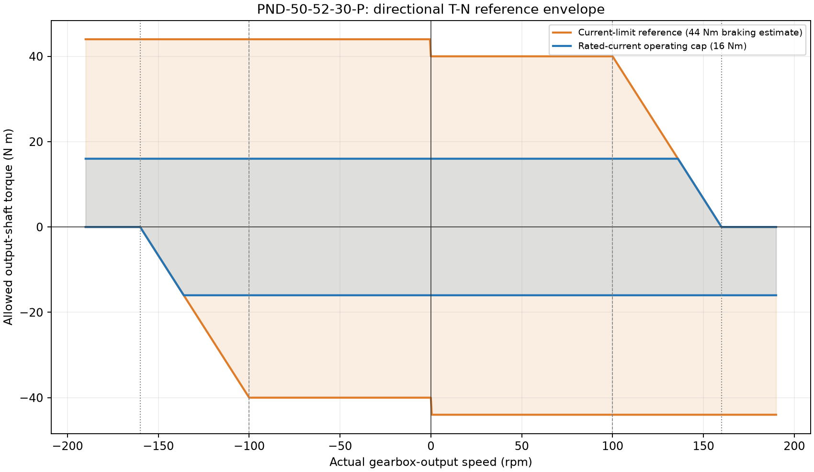

# 电机模型与 MuJoCo 一致性契约

## 1. 基准与证据等级

用户确认四个踝电机统一使用主表第 10 行 **PND-50-52-30-P** 及其附图，不把旧标题 PND-50-6F5S-30-P 当作未经核实的别名。

唯一数值入口是[电机配置](../src/pndbotics_ankle/data/pnd_50_52_30_p.json)，由[不可变 MotorSpec](../src/pndbotics_ankle/motor.py)读取。配置保留工作簿 SHA-256、工作表和单元格来源；原始工作簿、其他型号、设备网络信息均不上传。

| 来源 | 原始数据 / 定义 | 使用方式 |
|---|---|---|
| F1、F10 | 电机惯量列明确为仿真数据；0.61 × 10^-4 kg·m² | 不是实测转子辨识结果 |
| E10 | 减速器输入侧惯量为空 | 复现 Excel 空白参与求和的规则，不声称物理惯量为零 |
| G10、H10、I10 | 输入侧求和，减速比 30，再乘 30² | 输出侧已知惯量预算 0.0549 kg·m²，不再次折算 |
| J1、J10 | 测试输出侧扭矩常数 1.6 N·m/A | 不混入附件 2 的名义配置常数 |
| K10、L10 | 额定电流 10 A、限流 25 A | 推算 16 / 40 N·m，不构造未给出的电流动态 |
| M10、N1、N10 | Y1 = J10 × L10；Y2 = 1.1 × Y1 | 驱动 40；制动 44 是估算，不是独立实测 |
| O1、O10 | X1 = 100 rpm，标注为额定电流下速度 | 按附图作为参考拐点，不称 25 A 全扭矩实测拐点 |
| Q1、Q10 | X2 = 160 rpm，台架空载 | 参考驱动包络的零扭矩节点，不是机械硬限速 |
| U1、U10、附图 | Va = 190 rpm，摩擦全激活速度，另有 VESC 空载条件 | 仅保留元数据，不替换 X2 |
| S10、T10 | Fs/Fd 缺失 | 摩擦未辨识，不保留无来源的电机阻尼 6，也不冒称实测零摩擦 |

工作簿 rad/s 缓存使用 6.28 近似；代码从 rpm 用精确 `2*pi/60` 换算。附件 2 的 `0.0592 * 30 = 1.776 N·m/A`、`44.4 N·m` 属于另一套 adam lite PNDrive 配置，**不与主表测试常数混配**。

## 2. 轴侧、惯量预算与未校准部分

- 解析曲柄角、MJCF 电机 joint 都在减速器输出侧。两者仅差反号与零位；`gear=1` 是建模坐标约定，不是声称没有物理减速器。
- 物理减速比只用于 `I_out = I_input * N²`。输出侧扭矩和转速不再乘/除 N。
- 默认 `included_in_profile_total` 策略把 **0.0549** 作为本次电机轴模型的总惯量预算。
- 既有显式 motor body 在轴向已贡献 **0.0002**；保留其质量/空间惯量，以 **0.0547** 作为额外 joint `armature`。所以固定近端的编译后电机质量矩阵块合计仍是 **0.0549**，而不是 0.0551。
- 这是一项透明的**模型预算分摊**，不是工作簿测出隐藏惯量为 0.0547，也不是 CAD 已证明该 body 属于内部转子。原模型的空间质量分配、壳体/曲柄归属、浮动基耦合惯量没有在本次标定。
- 将来若 CAD 证明显式体是额外外部构件，可以显式选 `external_extra`，让它在电机内部预算之外计入；不得在默认策略下无意重复计数。
- 四个被动 pitch/roll joint 的无来源附加 armature 清零。刚体本身惯量仍由 MJCF 表达；**不再把 J^T I J 加回被动关节**。其他关节的参数不批量改写。
- 电机额外 damping/frictionloss 取 0 表示“未建模该未辨识项”。原有被动轴小阻尼、杆长 tendon 刚度/阻尼保留，属于原机构模型，不宣称来自电机表。

电机预算对踝坐标的反射为完整矩阵：

\[
M_{ref}(q)=J(q)^T\operatorname{diag}(I_{out,1},I_{out,2})J(q).
\]

其中包含耦合项。对角元素的逐轴扫描最大值不是一般的耦合矩阵保守上界，也不是显式电机模型中应再次添加的 armature。

## 3. 有方向的 T–N 模型

令 n 为实际输出轴转速的绝对值（rpm），工作簿参考驱动上界为：

\[
D(n)=\begin{cases}
40,&n\le100,\\
40(160-n)/60,&100<n<160,\\
0,&n\ge160.
\end{cases}
\]

`current_limit` 模式使用驱动 D、制动 B = 44。速度为正时允许 `[-B, D]`；速度为负时允许 `[-D, B]`。精确零速保守取 `[-40,40]`。反向转动采用同一方向关系的镜像模型。

**默认 `continuous`** 实际是“额定电流推算操作限额”：把上述区间与 `[-16,16]` 相交。它不是把整条峰值曲线乘 16/40，也不是声称有完整连续热能力曲线；驱动限额在 136 rpm 后才接上参考下降线，制动上界为 16。

例如 current-limit 模式下：

| 实际速度 | 请求 | 实际允许输出 |
|---:|---:|---:|
| +130 rpm | +100 N·m | +20 N·m，驱动降额 |
| +130 rpm | +10 N·m | +10 N·m，未饱和不缩放 |
| +130 rpm | −100 N·m | −44 N·m，反向制动估算 |
| +190 rpm | +100 N·m | 0，同向驱动关闭 |
| +190 rpm | −100 N·m | −44 N·m，仍保留制动 |

不能通过剪 `qvel` 制造硬限速。外载仍能拖动电机超过 160 rpm；超过已给节点的恒定制动是参考模型外推，**没有保证母线能吸收再生能量**。

44 N·m 若简单除以 1.6 会得到 27.5 A，超过表中 25 A，因此本模型不把这个估算制动扭矩冒充严格相电流模型。电压、R/L、Iq/RMS 定义、电流环、效率、峰值持续时间、温升、再生母线保护均未给定，不编造这些状态。MuJoCo 3.9 原生 dcmotor 需要额外电气数据，故本次不强行拟合为 dcmotor。



## 4. MuJoCo 运行时保证与边界

[MotorRuntime](../src/pndbotics_ankle/mujoco_motor.py)在 MuJoCo 的 actuation 阶段读取**实际** `actuator_velocity`，对输出轴扭矩请求做 clip。不会按目标速度限幅，不会把所有小请求乘一个降额系数。实际广义力读 `qfrc_actuator`，同时记录 `actuator_force`，避免遗漏 joint 层二次截断。

四个电机的 ctrl、actuator force、joint actuator force 静态护栏都是 ±44，动态回调再区分驱动 40 与制动 44。每个 `MjData.userdata` 保存独立的模式，重置数据后默认回到 continuous；批量 `mj_step(..., nstep=...)` 和积分子步也调用限幅，不依赖某个脚本外循环预处理。

- XML 使用 `fixed gain=0 + user bias`。**没有回调时为零电机输出**；不是不受 T–N 约束的原生 motor 回退。`gaintype=user` 缺回调默认 gain=1，并不满足这个 fail-closed 条件。
- MuJoCo 的 bias 回调是进程全局资源。本库拒绝静默覆盖第三方回调，多 Runtime 共享自身 dispatcher，关闭时只清除仍属于自己的 hook。
- 共享加载器在编译模型时，用全局锁暂时卸下自身 hook，规避 MuJoCo 3.9 Python 绑定在未包装编译态 model/data 上回调的问题；Runtime 的 forward/step 使用同一锁。**不要在另一个线程同时执行未加锁的裸 native step 与模型编译**。
- 外部库若强行替换全局 hook，受支持的 Runtime 入口会拒绝继续；任意第三方裸 native 调用无法由 Python 库强制保护。
- 原生 C++/GUI 单独打开 XML 不会带上 Python 函数，故四电机保持零输出。需要在宿主实现同一 ABI 规则，或使用本仓库支持的 Python 入口。

## 5. 复现与审计

```bash
pip install -e ".[sim,test]"
python scripts/configure_ankle_motor.py --check
python -m unittest discover -s tests -v
python scripts/kinematics/ankle_speed_torque.py
python scripts/kinematics/ankle_armature.py
python scripts/dynamics/ankle_motor_simulation.py --out artifacts/motor_validation
```

修改[单源配置](../src/pndbotics_ankle/data/pnd_50_52_30_p.json)后，运行[同步工具](../scripts/configure_ankle_motor.py)，再测试。`--check` 不写文件，XML 过期时失败；Runtime 也校验同轴、参数 ABI、惯量预算及三层护栏。

[电机驱动仿真](../scripts/dynamics/ankle_motor_simulation.py)固定近端小腿、启用重力、无地面接触/外载，保留原柔性 tendon。仅驱动两个电机，`qfrc_applied` 全为零。记录原始请求、动态上下界、限幅结果、实际广义扭矩、转速、功率、饱和及完整惯量分账。`mapped_joint_torque` 只是理想雅可比映射，不是已扣除电机/曲柄加速度及机构损耗的足端净扭矩。

测试设计见[电机测试计划](specs/plant-models/ankle-motor/ankle-motor-test-plan.md)。实际验证数据会另行列出，不能把通过软件一致性测试写成实物电机已标定。
