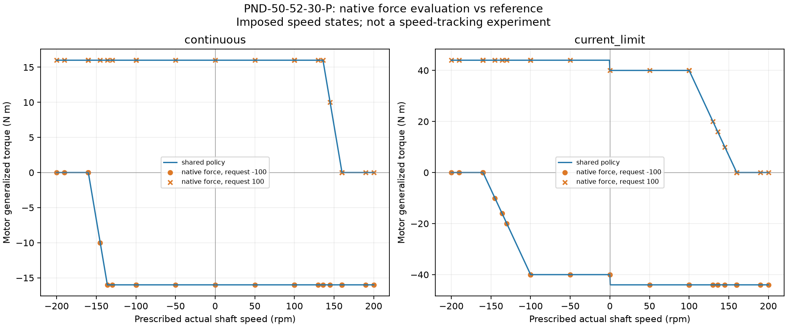

# 电机参数对齐验证结果

## 结论与范围

**PASS（软件模型一致性）**。四电机使用用户确认的第 10 行 PND-50-52-30-P；MuJoCo 原生实际广义驱动力、单源解析限幅及惯量预算一致。环境为 Windows、Python 3.13.0、MuJoCo 3.9.0、NumPy 2.4.4。

这不是实物台架标定、满载行走验证或连续热能力认证。证据层级和未辨识项见[电机契约](motor_model.md)。完整机器可读结果见[验证记录](motor_model_validation.json)。其中源 XML SHA 是本机文件字节指纹，换行格式不同可改变文件哈希，不改变物理参数。

## 已执行检查

| 检查 | 结果 |
|---|---|
| 纯参数、native runtime、全模型集成回归 | **81 项通过，0 失败、0 错误、0 跳过** |
| 四轴 × 两模式 × 25 个正负速度 × 9 个请求 | **1,800 个实际力评估**；最大实际广义扭矩误差 **0 N·m** |
| 编译电机质量矩阵块 | 四轴对角均为 **0.0549 kg·m²**；显式 0.0002 + 附加 0.0547 |
| 零回调 / 非法 ABI / hook 冲突 / 多 data 模式隔离 | fail-closed、拒绝冲突及隔离均通过 |
| 原生批量步进及 RK4 子步 | 原生内部限幅通过，不依赖外循环先剪 ctrl |
| profile/XML 缓存、左右 bench、Unicode include | 全部通过；递归 include 拒绝 |
| 28 秒电机驱动左踝，1 ms 步长 | **28,001 点**，实际扭矩越界 **0** |
| 同轨迹，0.5 ms 步长 | **56,001 点**，实际扭矩越界 **0** |
| 两组各 102 个状态重构 | 扭矩、加速度、tendon 长度及完整反射惯量矩阵最大差均 **0** |
| 单步推进下一状态 | 两组与记录的下一 qpos 最大差均 **0 rad** |
| 步长减半差异 | 最大位置差 **5.1885e-5 rad（约 0.002973°）**；最大扭矩差 **0.006472 N·m** |
| wheel 构建 | 通过；包含 canonical JSON 和 runtime 模块 |
| 原始工作簿 | 二进制 SHA-256 与初次读取一致，**未修改** |

### 原生 T–N 探针的代表值

下表处于显式 `current_limit` 参考模式，所有四个电机结果一致。速度是施加到状态的探针条件，用来验证力计算，**不是声称实物已跟踪到这些转速**。

| 实际轴速 | 请求 N·m | MuJoCo 实际 N·m | 解释 |
|---:|---:|---:|---|
| +130 rpm | +100 | +20 | 驱动降额 |
| +130 rpm | +10 | +10 | 不缩放未饱和请求 |
| +130 rpm | −100 | −44 | 反向制动估算 |
| +190 rpm | +100 | 0 | 超过驱动零扭矩节点 |
| +190 rpm | −100 | −44 | 仍保留制动，不硬剪转速 |



## 真实积分轨迹

近端小腿固定、重力开启、无地面接触与外载；保留原杆长柔性 tendon，仅给两个电机发扭矩请求，全部 `qfrc_applied=0`，没有给被动踝轴施加跟踪力矩。roll/pitch 旋转顺序为 `Ry(pitch) @ Rx(roll)`。

- 活动段 roll/pitch 跟踪 RMSE：**0.028824° / 0.099239°**。
- 最大实际电机扭矩：**0.230540 / 0.228845 N·m**。
- 最大绝对轴速：**0.590395 / 0.558951 rad/s**。
- 杆长最大偏差：**0.004954 / 0.005021 mm**。
- 该空载低速轨迹未触发饱和；高速/饱和限幅由独立的原生探针及积分子步测试核验，不能把空载力矩直接当作满载选型结果。

记录区分原始 request、动态 clip、实际 `qfrc_actuator` 与 `actuator_force`。完整 `J.T @ diag(0.0549,0.0549) @ J` 与额外 armature-only 反射项分别保留，不混为同一物理项。

## 复现命令

```bash
pip install -e ".[sim,test]"
python scripts/configure_ankle_motor.py --check
python -m unittest discover -s tests -v
python scripts/dynamics/ankle_motor_simulation.py --out artifacts/motor_validation
python scripts/dynamics/ankle_motor_simulation.py --dt 0.0005 --out artifacts/motor_validation/half-step
python scripts/dynamics/verify_motor_model.py --results artifacts/motor_validation --fine-results artifacts/motor_validation/half-step
```

原始工作簿拥有者可额外给验证器传 `--source-workbook`，仅比较哈希，不改写/分发文件。输出数据默认位于被忽略的实验目录。派生 XML 记录 VFS 网格名用于审计，不是包含全部资源的独立场景；请用仓库加载器重建。

## 必须保留的限制

- 转子惯量来自仿真列，减速器惯量缺失；本次分摊是选定的总轴预算政策，不是 CAD/惯量台架辨识。
- 100 rpm 是额定电流背景下的数据；40 N·m 到该拐点的曲线是按附图实现的**理想参考**，不是已测完整 25 A 曲线。
- 44 N·m 制动来自 +10% 估算，不能冒充严格 25 A 相电流或再生母线模型。
- `continuous` 只表示额定电流推算操作限额，不等于热稳定连续额定能力。电压、R/L、温升、峰值持续时间及摩擦均未编造。
- 此前交付的视频/旧复现包是原参数基线，**不作为本次更新后的验证证据**。新的代码、原生探针与积分遥测应以本记录为准。
